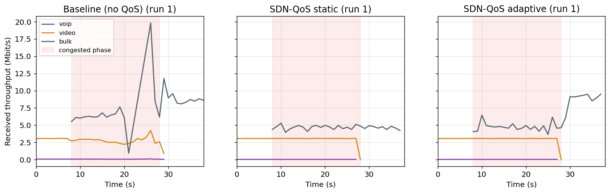

# SDN-Based QoS Management for Prioritized Network Traffic

Course project for Software Defined Networks, SRMIST (School of Computing, Dept. of
Networking and Communications).

A university data center carries a live video lecture, a VoIP helpdesk call and a large
nightly backup over one shared uplink. With plain best-effort forwarding, the backup fills
the uplink buffer and VoIP and video suffer. This project adds an **SDN QoS scheme**: a Ryu
controller classifies flows at the edge, gives VoIP and video priority queues, polices the
backup with OpenFlow 1.3 meters, and retunes the backup cap in a monitoring loop. Everything
runs on Open vSwitch inside Mininet, and every number in the docs comes from runs in this repo.

### Results at a glance (measured, 5 runs, 10 Mbit/s bottleneck, congested phase)

| | Baseline (best effort) | SDN-QoS static | SDN-QoS adaptive |
|---|---|---|---|
| VoIP mean one-way delay | 879 ms | 5.7 ms | 5.7 ms |
| VoIP p95 delay | 1670 ms | 7.5 ms | 7.2 ms |
| VoIP / video packet loss | 4.1 % / 3.3 % | 0 % / 0 % | 0 % / 0.02 % |
| Bulk throughput while VoIP+video active | 6.1 Mbit/s | 4.7 Mbit/s | 4.6 Mbit/s |
| Bulk throughput after VoIP+video stop | 8.8 Mbit/s | 4.7 Mbit/s | **8.2 Mbit/s** |

Welch t-test baseline vs QoS on VoIP delay: p = 5e-8. See
[RESULTS.md](experiments/results/RESULTS.md) for all metrics and CIs.



| | |
|---|---|
| Controller | Ryu 4.34 on Python 3.9 (separate venv), OpenFlow 1.3 |
| Data plane | Open vSwitch 2.17 kernel datapath, Mininet 2.3.0, Ubuntu 22.04 |
| QoS mechanisms | per-flow classification, DSCP re-marking, OpenFlow meters (drop band), OVS HTB priority queues |
| QoS loop | 1 classify -> 2 policy decision -> 3 rule install -> 4 priority queuing -> 5 monitor and adapt |
| Northbound | REST API (`ryu.app.wsgi`) on port 8080 |
| Analysis | Python 3.11 venv: pandas, numpy, scipy, matplotlib |

Documentation:
* [docs/report.md](docs/report.md) is the full report (literature, design, results, limitations).
* [docs/architecture.md](docs/architecture.md) has the three-plane diagram, pipeline tables and sequence diagram.
* [experiments/results/RESULTS.md](experiments/results/RESULTS.md) holds the generated result tables.
* [docs/evidence/](docs/evidence) has the flow, meter and queue dumps, controller logs and the REST demo transcript.

---

## 1. Quick start

Mininet and Open vSwitch need a Linux kernel, so on macOS and Windows the setup scripts
create a small **Ubuntu 22.04 VM** (4 vCPU, 4 GB RAM, about 20 GB disk) and install
everything inside it. You need about 8 GB of free RAM, 25 GB of free disk and an internet
connection.

### macOS (Apple Silicon or Intel, macOS 13+)

```bash
git clone https://github.com/dheeraj-juvvadi/sdn-qos.git
cd sdn-qos
bash scripts/host/setup_mac.sh          # Homebrew + Lima + VM + `make setup verify test`
bash scripts/host/run_mac.sh run-all    # full reproduction (about 45 min)
```

The VM mounts the repository, so results appear directly in `experiments/results/` and
`docs/figures/` on the Mac. To get a shell in the VM, run
`limactl shell --workdir /mnt/sdn-qos sdn-qos`.

### Windows 10/11

Open **PowerShell as Administrator**:

```powershell
winget install -e --id Git.Git          # skip if git is installed
git clone https://github.com/dheeraj-juvvadi/sdn-qos.git
cd sdn-qos
Set-ExecutionPolicy -Scope Process Bypass -Force
.\scripts\host\setup_windows.ps1        # Multipass + VM + `make setup verify test`
.\scripts\host\run_windows.ps1 run-all  # runs in the VM, then copies results back
```

Multipass uses Hyper-V on Windows Pro/Enterprise and VirtualBox on Windows Home. If the
installer asks for a reboot, reboot and run `setup_windows.ps1` again. To get a shell in
the VM, run `multipass shell sdn-qos`, then `cd ~/sdn-qos`.

### Ubuntu 22.04 (native, or any VM you already have)

```bash
git clone https://github.com/dheeraj-juvvadi/sdn-qos.git && cd sdn-qos
make setup      # apt packages + /opt/sdn-qos/venv-ryu (py3.9) + /opt/sdn-qos/venv-analysis (py3.11)
make verify     # versions + OVS meter check + Ryu app load test
make run-all
```

`make setup` is idempotent. It installs the deadsnakes PPA (for Python 3.9),
`mininet`, `openvswitch-switch`, `iperf3`, `tcpdump`, `d-itg` and the pinned Python
packages from `requirements-ryu.txt` and `requirements-analysis.txt`. Every
version is pinned (`pip freeze`).

## 2. Make targets (run inside the VM / Ubuntu, from the repo root)

| Target | What it does | Time |
|---|---|---|
| `make setup` | install all tools and both venvs | 5-10 min |
| `make verify` | print versions, test `ovs-ofctl add-meter`, load the Ryu app | 10 s |
| `make test` | 26 unit tests (classifier with synthetic headers, policy model) | 1 s |
| `make smoke` | live: `pingall`, `iperf3`, dump flows, meters and queues to `docs/evidence/smoke/` | 30 s |
| `make run-baseline` / `make run-qos` | baseline only / static + adaptive only, `RUNS` times each | 8 / 16 min |
| `make run-main` | baseline, static and adaptive, interleaved, `RUNS` (default 5) times each | 13 min |
| `make run-sweep` | bottleneck 5/10/20 Mbit/s and 1/2/4 bulk streams, baseline vs adaptive, `SWEEP_RUNS` (default 2) each | 13 min |
| `make run-meteronly` | R1 demo: meter-only policy with a loose bulk cap, static vs adaptive | 4 min |
| `make challenges` | Phase 9 limitation experiments (SPOF, scale, control latency, table, security) | 6 min |
| `make rest-demo` | change the bulk cap via REST at runtime, measured with iperf3 | 1 min |
| `make plots` | parse the raw runs, then write CSVs, `RESULTS.md` and figures | 30 s |
| `make evidence` | copy flow, meter and queue dumps and stage logs into `docs/evidence/` | 1 s |
| `make run-all` | all of the above in order | ~45 min |
| `make clean-net` | kill stray controller and traffic processes, `mn -c` | |
| `make clean` | `clean-net` + delete generated results | |

Use `RUNS=10 SWEEP_RUNS=3 make run-all` for tighter confidence intervals. Completed runs are skipped, so an
interrupted batch can be resumed by running the same command again.

## 3. Running the pieces by hand

Use two terminals in the VM.

```bash
# terminal 1: controller (mode = baseline | static | adaptive)
QOS_MODE=adaptive QOS_LOG_DIR=/tmp/qos PYTHONPATH=. \
  /opt/sdn-qos/venv-ryu/bin/ryu-manager --ofp-tcp-listen-port 6633 --wsapi-port 8080 \
  controller/qos_controller.py

# terminal 2: topology with the Mininet CLI (use --qos baseline with QOS_MODE=baseline)
sudo python3 topology/topo_qos.py --bw 10 --delay 5 --qos qos --cli
mininet> pingall
mininet> h6 iperf3 -s -D
mininet> h3 iperf3 -c 10.0.0.6 -t 10
mininet> sh ovs-ofctl -O OpenFlow13 dump-flows s1
mininet> sh ovs-ofctl -O OpenFlow13 dump-meters s1
mininet> sh tc -s class show dev s1-eth4
```

Controller environment variables:

| Variable | Default | Meaning |
|---|---|---|
| `QOS_MODE` | `adaptive` | `baseline` (learning switch only), `static`, `adaptive` |
| `QOS_POLICY` | `policies/default_policy.yaml` | policy file (YAML or JSON) |
| `QOS_LOG_DIR` | `experiments/results/live` | controller log, classification log, monitor series, adaptation events |
| `QOS_BOTTLENECK` | `1:4` | `dpid:port` used for link utilisation |
| `QOS_LINK_KBPS` | from policy | bottleneck capacity for utilisation |
| `QOS_PKTIN_LIMIT` | `0` (off) | PacketIn token-bucket limit (pkt/s), a DoS mitigation |
| `QOS_FLOW_IDLE` | `30` | idle timeout (s) of classified flow entries |

One full scenario (38 s of traffic) with all logs:

```bash
sudo python3 traffic/run_scenario.py --mode adaptive --out /tmp/run1
```

## 4. Northbound REST API

From inside the VM the API is at `http://127.0.0.1:8080`. On a Mac it is also
forwarded to `http://localhost:18080`.

```bash
curl -s http://127.0.0.1:8080/qos/policy                 # active policy
curl -s http://127.0.0.1:8080/qos/classes                # classes + active flow count
curl -s http://127.0.0.1:8080/qos/flows                  # classified flows with kbit/s
curl -s http://127.0.0.1:8080/qos/stats                  # per-class rates, utilisation, meter, PacketIn
curl -s -X PUT http://127.0.0.1:8080/qos/policy \
     -d '{"classes":{"bulk":{"cap_kbps":2000}}}'          # change the bulk cap at runtime
curl -s -X POST http://127.0.0.1:8080/qos/reset          # back to the start-up policy
```

Measured with `make rest-demo` (one bulk TCP stream, static mode; transcript in
[docs/evidence/rest_demo.txt](docs/evidence/rest_demo.txt)):

| Time | Policy via REST | Bulk throughput (iperf3) |
|---|---|---|
| 0-10 s | start-up cap 5000 kbit/s | 4.79 Mbit/s |
| 10-20 s | `PUT {"classes":{"bulk":{"cap_kbps":2000}}}` | 1.85 Mbit/s |
| 20-30 s | `PUT {"classes":{"bulk":{"cap_kbps":8000}}}` | 7.65 Mbit/s |

## 5. What the outputs are

| Path | Content |
|---|---|
| `experiments/results/raw/<config>/run_NN/` | per-run raw data (gitignored): receiver CSVs with per-packet timestamps, iperf3 JSON, controller log, `classification_log.csv`, `monitor_series.jsonl`, `adaptation_events.csv`, flow/meter/queue dumps |
| `experiments/results/runs.csv` | one row per run, every metric |
| `experiments/results/summary.csv` | mean, std, 95% CI per configuration and metric |
| `experiments/results/stats_tests.csv` | Welch t-test and Mann-Whitney U, baseline vs QoS |
| `experiments/results/timeseries.csv` | per-second throughput per class |
| `experiments/results/RESULTS.md` | generated tables (the report quotes these) |
| `experiments/results/challenges/*.json` | Phase 9 measurements |
| `docs/figures/*.png` | latency CDF, throughput timelines, bar charts, adaptation timeline, sweep |
| `docs/evidence/` | `dump-flows`, `dump-meters`, queue stats, controller stage logs, REST transcript |

How the metrics are measured:
* **One-way delay** is `recv_ts - send_ts`, stamped in every UDP packet. All
  Mininet hosts share one kernel clock, so no clock sync is needed.
* **Jitter** is the RFC 3550 interarrival jitter estimator.
* **Loss** is computed from sequence numbers against the planned packet count.
* **Bulk throughput** comes from the iperf3 receiver-side JSON, per stream per second.
  Jain's index is computed over the bulk streams.
* **Utilisation** is the s1 bottleneck port `tx_bytes` delta from OpenFlow port stats.
* **Flow-setup time** is measured in the controller from PacketIn arrival until the
  FlowMod is sent. The end-to-end setup cost (first-packet RTT) is measured in the
  Phase 9 experiments.

## 6. Troubleshooting

| Symptom | Fix |
|---|---|
| `ryu-manager` crashes with `AttributeError: module 'collections' has no attribute 'MutableMapping'` or eventlet errors | Ryu only works on Python 3.9 or older. Use `/opt/sdn-qos/venv-ryu` (Python 3.9, eventlet 0.30.2, dnspython 1.16.0). `make setup` builds it. |
| `pip` fails building Ryu (`use_2to3`, `easy_install`) | Ryu 4.34 needs `setuptools==57.5.0` and `--no-build-isolation`. `setup_vm.sh` does this. |
| `ovs-ofctl add-meter` fails with `OFPMMFC_*` / meters missing | kernel datapath too old. Check with `make verify`. Use `datapath_type=netdev` for the bridges or set `enforcement: queue` in the policy (HTB queues only). Ubuntu 22.04 (Linux 5.15) supports drop-band meters. |
| `Exception: Error creating interface pair` / `RTNETLINK answers: File exists` | a previous run did not exit cleanly. Run `make clean-net`. |
| `another experiment batch is already running` | only one batch can run at a time (lock in `/tmp`). Wait, or `make clean-net`. |
| `pingall` loses packets | the controller is not running or is listening on the wrong port. Mininet uses `127.0.0.1:6633`. Check `experiments/results/*/ryu_stdout.log`. |
| REST API unreachable from the Mac | use `http://localhost:18080` (forwarded by Lima), or run curl inside the VM. |
| Windows: `winget` not found | install "App Installer" from the Microsoft Store, or install Multipass from <https://multipass.run/install>. |
| Windows Home: VM will not start | Multipass needs VirtualBox there. Install VirtualBox, then run `multipass set local.driver=virtualbox`. |
| Windows: `bash\r: No such file` | the files were checked out with CRLF. The repo's `.gitattributes` forces LF, so re-clone with a current git. |

## 7. Repository layout

```
sdn-qos/
├── Makefile                      setup, verify, test, smoke, run-*, challenges, rest-demo, plots, clean
├── requirements-ryu.txt          pinned Ryu venv (Python 3.9)
├── requirements-analysis.txt     pinned analysis venv (Python 3.11)
├── controller/                   Ryu app: qos_controller, classifier, policy, meters_queues, monitor, rest_api
├── policies/default_policy.yaml  classes, priorities, queues, meters, adaptation thresholds
├── topology/                     topo_qos.py (Mininet), setup_queues.sh (OVS HTB queues)
├── traffic/                      udp_flow.py, gen_voip/video/bulk, flow_burst.py, run_scenario.py
├── experiments/                  run_experiments.py, challenges.py, rest_demo.py, results/
├── analysis/                     parse_results.py, make_plots.py, summarize.py
├── tests/                        unit tests + live smoke test
├── scripts/                      setup_vm.sh, verify_env.sh, cleanup_net.sh, collect_evidence.sh,
│                                 lima.yaml, host/ (setup_mac.sh, setup_windows.ps1, run_*)
└── docs/                         report.md, architecture.md, figures/, evidence/
```

## 8. Known deviations and limitations

* **Meters use the drop band only.** The OVS kernel datapath on Linux 5.15 reports
  `band_types: drop`, so the policy's DSCP re-marking uses `set_field` actions instead of a
  `dscp_remark` meter band. Both meters and HTB queues are implemented behind one interface
  (`enforcement: meter | queue | both`).
* **The bottleneck delay is re-added under HTB.** OVS replaces the root qdisc that
  Mininet's `TCLink` put on `s1-eth4`, so `setup_queues.sh` re-adds the 5 ms delay as a
  netem leaf under each HTB class. The reverse direction keeps TCLink's own shaping.
* **D-ITG is installed but not used.** VoIP and video are generated by the stdlib
  `udp_flow.py`, which gives exact one-way delay per packet.
* **The ML/DRL classifier (Phase 8) and s1-s3-s2 re-routing are not implemented.** They are
  future work, per the project brief. Adding s3 would also create a loop, which the L2
  learning switch does not handle without STP.
* **Testing coverage.** The macOS (Lima, Apple Silicon) and Ubuntu paths were run end to
  end. The Windows (Multipass) scripts follow Multipass's documented CLI but were not run
  on a Windows machine for this submission.
