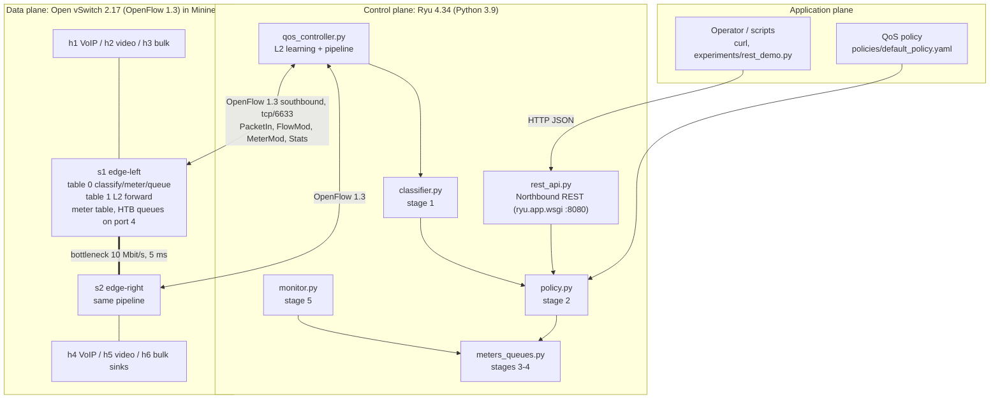
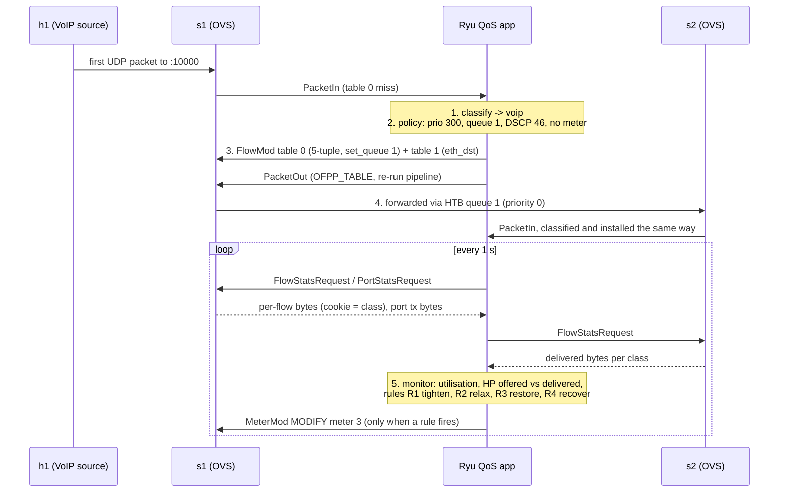

# Architecture

## Three-plane view

## Components and roles

| Component | File | Plane | Role |
|---|---|---|---|
| Policy document | `policies/default_policy.yaml` | Application | Classes, priorities, DSCP, queue/meter ids, rates, adaptation thresholds |
| REST API | `controller/rest_api.py` | App to control (northbound) | `GET/PUT /qos/policy`, `GET /qos/flows`, `/qos/stats`, `/qos/classes`, `POST /qos/reset` |
| QoS controller | `controller/qos_controller.py` | Control | Switch setup, PacketIn handling, MAC learning, rule installation, PacketIn rate limiter, error counting |
| Classifier | `controller/classifier.py` | Control | Stage 1: header rules (ports, protocol, DSCP) from the policy; decision log |
| Policy model | `controller/policy.py` | Control | Stage 2: validated, thread-safe policy with runtime update/reset |
| Enforcer | `controller/meters_queues.py` | Control | Stages 3-4: OFPMeterMod (drop band), Meter instruction, set_field DSCP, OFPActionSetQueue |
| Monitor | `controller/monitor.py` | Control | Stage 5: flow/port stats every 1 s, per-class rates, utilisation, adaptation rules R1-R4, heavy-hitter promotion |
| Topology | `topology/topo_qos.py` | Data | 6 hosts, 2 OVS switches, 100 Mbit/s access, 10 Mbit/s / 5 ms bottleneck |
| Queues | `topology/setup_queues.sh` | Data | OVS `linux-htb` QoS: queue 0 BE, 1 VoIP, 2 video, 3 bulk, plus netem delay leaves |
| Traffic | `traffic/*.py` | Hosts | VoIP (G.711-like), video (3 Mbit/s RTP-like), bulk (iperf3 TCP) |

## OpenFlow pipeline on every switch

| Table | Priority | Match | Instructions | Installed |
|---|---|---|---|---|
| 0 | 300 | 5-tuple of a VoIP flow | write(set dscp 46, set_queue 1), goto 1 | reactive, idle 30 s |
| 0 | 200 | 5-tuple of a video flow | write(set dscp 34, set_queue 2), goto 1 | reactive |
| 0 | 100 | 5-tuple of a bulk flow | meter:3, write(set dscp 8, set_queue 3), goto 1 | reactive |
| 0 | 10 | 5-tuple of other IPv4 flows | write(set dscp 0, set_queue 0), goto 1 | reactive |
| 0 | 5 | ARP | goto 1 | proactive |
| 0 | 0 | any (table miss) | output CONTROLLER | proactive |
| 1 | 1 | eth_dst | write(output port) | learned |
| 1 | 0 | any (table miss) | output CONTROLLER | proactive |

In baseline mode, table 0 has a single `goto 1` rule. There is no classification,
no meter and no set_queue, so every packet shares one FIFO queue (a traditional
best-effort network).

Write-actions are used so that `set_queue` and `set_field` sit in the same action set
as the `output` added by table 1. OpenFlow executes set-field, then set-queue, then output.

## QoS enforcement loop (sequence)

## Why both meters and queues

* **Meters** (OpenFlow 1.3 meter table) police bulk at the ingress edge and are
  programmable at runtime with `OFPMeterMod MODIFY`. The adaptive loop uses this.
  On the Ubuntu 22.04 kernel datapath (Linux 5.15) OVS reports `max_bands:1,
  band_types: drop`, so a `dscp_remark` band is not available. DSCP is
  re-marked with `set_field` instead.
* **Queues** (OVS `linux-htb`) give VoIP and video a guaranteed rate and strict
  borrowing priority on the bottleneck port. They are work-conserving, so bulk can
  still use idle capacity. Queues cannot be created over OpenFlow, so
  `setup_queues.sh` creates them and the controller only selects them.

`enforcement: meter | queue | both` in the policy switches the mechanism without
code changes. Experiments use `both`.
