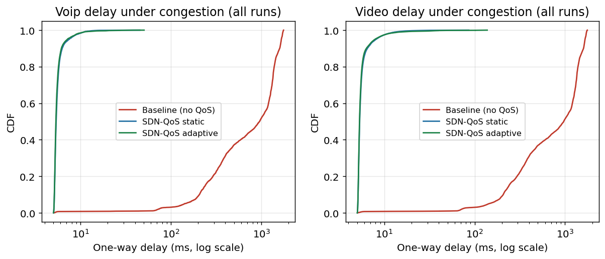
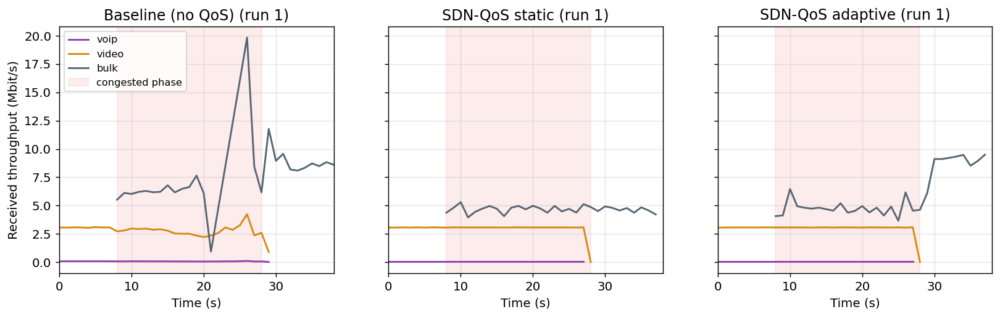
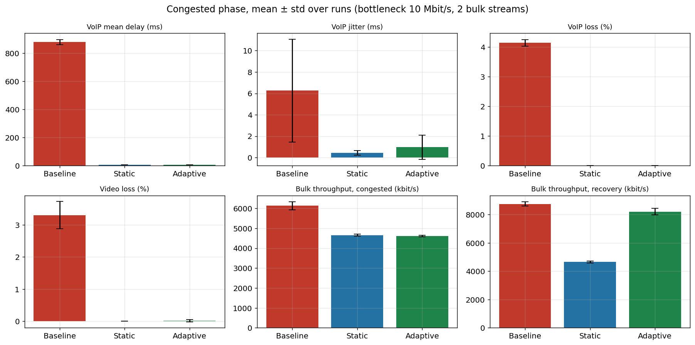
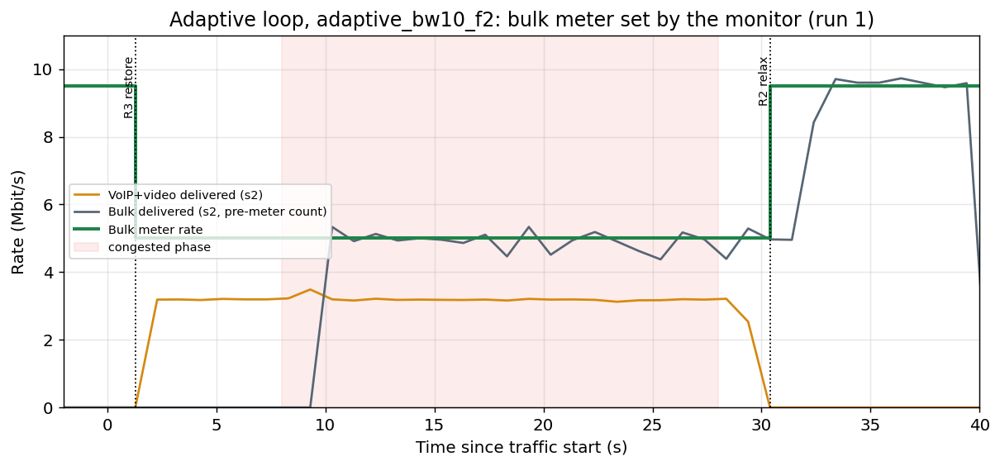
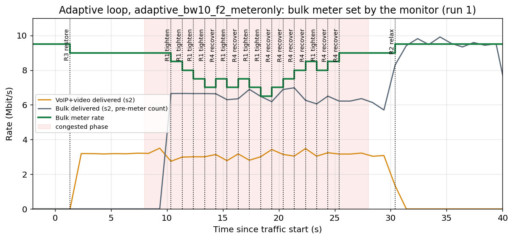
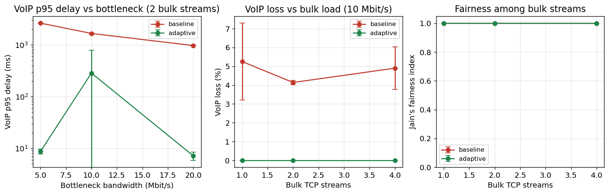

# SDN-Based QoS Management for Prioritized Network Traffic

Software Defined Networks: Use Case Project Report
SRM Institute of Science and Technology, School of Computing, Dept. of Networking and Communications

---

## Abstract

Mixed traffic on a shared uplink (VoIP, live video and bulk backup) collapses under
best-effort forwarding: a backup fills the bottleneck buffer and voice and video packets
wait behind it. This project designs, implements and evaluates an SDN QoS scheme on
Mininet with Open vSwitch (OpenFlow 1.3) and a Ryu controller. A five-stage loop
classifies each flow at the edge from policy-driven header rules, decides its treatment
from a YAML policy, installs per-flow rules with DSCP re-marking, priority queue selection
(OVS HTB) and OpenFlow meters, and monitors flow and port statistics every second to
retune the bulk meter. A northbound REST API changes the policy at runtime. Over 5
repeated runs on a 10 Mbit/s bottleneck, mean VoIP one-way delay under congestion fell
from **879 ms to 5.7 ms** (p95 from 1.67 s to 7.4 ms), and VoIP and video loss fell from
**4.1 % and 3.3 % to 0 %** (Welch p < 1e-7). The protection held for bottlenecks of
5-20 Mbit/s and 1-4 bulk streams. Bulk lost 24 % of its throughput while VoIP and video
were active. The adaptive loop returned the idle capacity afterwards: 8.2 Mbit/s against
4.65 Mbit/s for a static cap. Further experiments quantify the limits of centralised
control: controller failure, flow-setup saturation above about 800 new flows/s, control
latency amplified about 8x for reactive setup, flow-table overflow, and PacketIn floods,
mitigated here with a PacketIn rate limiter.

---

## 1. Introduction and motivation

Data-center and enterprise networks carry very different traffic over the same links.
Interactive voice needs low, stable delay: ITU-T G.114 recommends at most 150 ms one way
for good conversational quality. Live video needs a steady few Mbit/s with little loss.
Bulk transfers such as backups only care about finishing eventually. Traditional
networks forward all of it best effort through FIFO queues. When a bulk TCP transfer
fills a shared uplink, the queue in front of that link grows until it overflows. Every
VoIP and video packet then waits behind it (bufferbloat) and some are dropped.
Per-device QoS configuration (class maps, policers, queue profiles on each router) can fix
this, but it is static, error-prone and hard to keep consistent across a network.

SDN separates the control plane from the data plane. One logically centralised
controller sees every edge switch, so it can classify traffic, install consistent priority
and policing rules network-wide, and adapt them to measured load from one program.

**Scenario.** A university data center carries a live video lecture, a VoIP helpdesk call
and a nightly backup over the same uplink. Without QoS the backup starves VoIP and video.
With the SDN scheme in this project, flows are classified at the edge, VoIP and video are
mapped to protected priority queues, and the backup is policed by an OpenFlow meter. A
monitoring loop relaxes that cap when the interactive traffic goes idle, so the backup
can use the leftover bandwidth.

**Objectives.**
1. Design an SDN QoS scheme that classifies and prioritises traffic by application need.
2. Implement it with Ryu and Open vSwitch (OpenFlow 1.3) in Mininet.
3. Measure latency, jitter, loss, throughput and congestion against a non-prioritised baseline.
4. Document the findings and the limitations, and propose future work (ML/DRL prioritisation).

These map onto the review milestones: M1 (controller and topology), M2
(classification and priority rules), M3 (performance against baseline) and M4 (analysis
and documentation).

## 2. Literature review

| # | Paper | Key idea | How it informed this design |
|---|---|---|---|
| 1 | Aguirre Sanchez, Shen and Guo, *DQS: A QoS-driven routing optimization approach in SDN using deep reinforcement learning*, JPDC, 2024 | DRL agent picks paths from link bandwidth, delay, loss and queue state. A lightweight classifier looks at the first 3 packets of a flow. Prototype on Ryu. | Confirms that **Ryu plus early-packet classification** is a workable prototype stack. Our classifier also decides on the first packet at the edge. A learned agent (DQS-style) is the natural replacement for our rule-based adaptation (future work, Section 9). |
| 2 | Gunavathie and Umamaheswari, *MLPRS: A machine learning-based proactive re-routing scheme for flow classification and priority assignment*, J. Engineering Research, 2023 | KNN flow classification assigns priority, then proactive re-routing on high-betweenness links. | Separates **classification** from **priority assignment** the same way we split `classifier.py` from `policy.py`. Our heavy-hitter promotion (best effort above 2 Mbit/s for 3 s becomes bulk) is a simple stand-in for MLPRS's flow-feature classification. |
| 3 | Chen, Lin, Hsu, Sun, Huang and Hsiao, *Adaptive traffic control: OpenFlow-based prioritization strategies for achieving high QoS in SDN*, IEEE TNSM, 2025 | Assigns OpenFlow priority levels with Lagrangian relaxation on an M/G/1 priority-queue model to minimise end-to-end delay. | Motivates **strict priority between classes**: VoIP above video above bulk in both flow-table priority and HTB borrowing priority. Their queueing view also explains our baseline: a FIFO queue in front of a saturated link makes delay grow with buffer occupancy. |
| 4 | Shahriar et al., *Prioritized multi-tenant traffic engineering for dynamic QoS provisioning in autonomous SDN-OpenFlow edge networks*, IEEE, 2024 | OpenFlow **meter tables** reserve bandwidth for high priority and share the rest among lower priorities. | Directly adopted: the bulk class is **policed with an OpenFlow 1.3 meter**, and the adaptive loop retunes the meter rate (`OFPMeterMod MODIFY`) to hand unused high-priority capacity to bulk. |
| 5 | Beshley, Kryvinska, Beshley, Panchenko and Medvetskyi, *Traffic engineering and QoS/QoE supporting techniques for emerging service-oriented SDN* (SOSDN), JCN, 2024 | SLA/QoE-driven adaptive prioritisation and multi-criteria QoS routing. | Shaped the **policy-as-data** design: per-class SLA parameters (guaranteed rate, max rate, DSCP, priority) live in a YAML policy that can be changed at runtime through the northbound REST API. |

## 3. System design

### 3.1 Architecture

The design follows the three SDN planes. Full diagrams are in
[architecture.md](architecture.md).

* **Application plane.** The QoS policy (`policies/default_policy.yaml`) and the operator
  tools that call the northbound REST API.
* **Control plane.** One Ryu application with five modules: classifier, policy model,
  enforcer (meters and queues), monitor and REST API.
* **Data plane.** Two OpenFlow 1.3 Open vSwitch edge switches, each with a two-table
  pipeline, a meter table and HTB priority queues on the bottleneck port.
* **Southbound.** OpenFlow 1.3 over TCP 6633.

### 3.2 Traffic classes and policy

| Class | Match (first packet) | Flow priority | DSCP | HTB queue (min rate, borrow prio) | Meter |
|---|---|---|---|---|---|
| VoIP | UDP dst 5060 or 10000-20000, or DSCP 46 | 300 | EF 46 | q1: 0.5 Mbit/s, prio 0 | none (never limited below demand) |
| Video | UDP dst 5004, or DSCP 34 | 200 | AF41 34 | q2: 4 Mbit/s, prio 1 | none |
| Bulk | TCP 5201 (either direction), TCP 20/21; heavy best-effort flows | 100 | CS1 8 | q3: 1 Mbit/s, prio 2 | meter 3, drop band; 5 Mbit/s cap while VoIP/video active, 9.5 Mbit/s when idle |
| Best effort | everything else | 10 | 0 | q0: 0.5 Mbit/s, prio 3 | none |

All queues may borrow up to the full 10 Mbit/s link rate (`ceil`), so HTB is
work-conserving. The guaranteed rates add up to 6 Mbit/s, below the link capacity.

### 3.3 The five-stage QoS loop

| Stage | Where | Mechanism | Trace in logs |
|---|---|---|---|
| 1. Traffic classification | `classifier.py`, called on PacketIn | first-packet header rules from the policy; heavy-hitter promotion from the monitor | `classification_log.csv` (timestamp, dpid, 5-tuple, DSCP, class, setup time); `STAGE1-3` lines |
| 2. Policy decision | `policy.py` | class gives priority, DSCP, queue id, meter id and rates | `STAGE1-3 ... prio= queue= meter=` |
| 3. Rule installation | `meters_queues.py`, `qos_controller.py` | `OFPFlowMod` (5-tuple, cookie = class id, idle 30 s), `OFPMeterMod`, Meter instruction, `set_field`, `OFPActionSetQueue` | `STAGE3 meter add`, `dump-flows`, `dump-meters` |
| 4. Priority queuing and forwarding | OVS `linux-htb` on `s1-eth4` | queue selected per class; HTB serves min rates first, then lends spare bandwidth in priority order | `queue-stats`, `tc -s class show` |
| 5. Monitoring and feedback | `monitor.py` | Flow and port stats every 1 s. Per-class rates are taken at ingress (s1) and egress (s2), utilisation from s1 port 4. Rules R1-R4 drive `OFPMeterMod MODIFY`. | `monitor_series.jsonl`, `adaptation_events.csv`, `STAGE5 adapt` lines |

**Adaptation rules (stage 5).** They are kept simple so every decision can be explained:

* **R1 tighten.** If utilisation is above 90 % and VoIP+video delivered at s2 is below
  95 % of VoIP+video offered at s1, cut the bulk meter by 500 kbit/s (floor 1 Mbit/s).
* **R2 relax.** If VoIP+video is below 50 kbit/s for 2 polls, raise the bulk meter to its
  maximum (9.5 Mbit/s). This is the work-conserving step.
* **R3 restore.** If VoIP+video becomes active while the bulk meter is above its cap, set
  it back to the cap (5 Mbit/s).
* **R4 recover.** If VoIP+video is active and not losing packets and the meter is below
  the cap, raise it by 500 kbit/s.

### 3.4 Baseline ("traditional network")

The baseline uses the same topology, the same 10 Mbit/s bottleneck and the same
1000-packet buffer. The controller acts as a plain L2 learning switch: no
classification, meters or queue selection, so all traffic shares one FIFO HTB class.
The only difference between baseline and QoS runs is therefore the QoS scheme.

## 4. Implementation

| Module | Lines of note |
|---|---|
| `controller/qos_controller.py` | Ryu app (OpenFlow 1.3). On switch connect it clears the tables, installs meters, an ARP rule, and table-miss entries to the controller in tables 0 and 1. On PacketIn it learns the MAC, classifies (non-baseline modes), installs the 5-tuple entry in table 0 and the `eth_dst` entry in table 1, then re-injects the packet with `OFPP_TABLE` so the first packet gets the same treatment as the rest. It also has a token-bucket PacketIn limiter and counts OpenFlow errors. |
| `controller/classifier.py` | Pure function `classify(headers, classes)`. Rules are tried in class-priority order. Also an append-only CSV decision log. |
| `controller/policy.py` | YAML/JSON loader, validation (dscp range, min ≤ max, all classes present), thread-safe `update()` and `reset()` for the REST API. |
| `controller/meters_queues.py` | `Enforcer`: meter add/modify (kbps, drop band, burst = 100 ms of rate). Builds the per-class instruction list: Meter, write-actions(set_field dscp, set_queue), goto table 1. |
| `controller/monitor.py` | Stats polling thread, per-flow byte deltas keyed by match, per-class rates from the cookie, utilisation, rules R1-R4, heavy-hitter promotion, JSONL time series. |
| `controller/rest_api.py` | `ryu.app.wsgi` controller: `GET/PUT /qos/policy`, `GET /qos/flows`, `GET /qos/stats`, `GET /qos/classes`, `POST /qos/reset`. A PUT re-installs meters and flushes the classified entries, so flows are re-classified under the new policy on their next packet. |
| `topology/topo_qos.py` | Mininet: h1-h3 on s1, h4-h6 on s2, 100 Mbit/s access links, one s1-s2 TCLink (bandwidth and delay are parameters), remote controller 127.0.0.1:6633, `fail-mode=secure`. |
| `topology/setup_queues.sh` | `ovs-vsctl` linux-htb QoS on `s1-eth4` (1 queue in baseline, 4 in QoS), plus a 5 ms netem leaf (limit 1000 packets) under every HTB class. |
| `traffic/udp_flow.py` | CBR UDP sender and receiver. Every packet carries a sequence number and send time. The sender sets IP TOS from the DSCP. |
| `traffic/run_scenario.py` | Starts Ryu and Mininet, warms up ARP/MAC learning with `pingAll`, starts receivers and senders at an agreed absolute time, dumps OVS state mid-congestion, writes `meta.json`. |
| `experiments/run_experiments.py` | N repetitions per configuration, interleaved (baseline, static, adaptive, baseline, ...) so slow drift in the VM affects all modes equally. Resumable, with a lock against concurrent batches. |
| `analysis/*.py` | Parsing, statistics (mean, std, t-based 95 % CI, Welch t-test, Mann-Whitney U), figures and the generated `RESULTS.md`. |

**Problems hit during implementation and how they were solved:**

* **Ryu on modern Python.** Ryu 4.34 fails on Python 3.10+, and its `setup.py` fails on
  setuptools 58+. The fix is a Python 3.9 venv (deadsnakes) with `setuptools==57.5.0`,
  `--no-build-isolation`, `eventlet==0.30.2` and `dnspython==1.16.0`. eventlet 0.30.2
  rejects dnspython 2.x, which pip reported as `ResolutionImpossible`.
* **Meter band support.** `ovs-ofctl meter-features` on the Linux 5.15 kernel datapath
  reports `max_bands:1, band_types: drop`. Meters work, but a `dscp_remark` band does not,
  so remarking uses `set_field` actions.
* **OVS HTB versus Mininet TCLink.** Both use `tc`. OVS replaces the root qdisc on the
  bottleneck port, which removes TCLink's delay. `setup_queues.sh` puts the delay back as a
  netem leaf under each HTB class.
* **First packet treatment.** Sending the PacketOut directly to a port would skip the meter
  and queue. Re-injecting with `OFPP_TABLE` runs the just-installed entry.

## 5. Experimental setup

| Item | Value |
|---|---|
| Host | MacBook (Apple Silicon, 16 GB) running Lima VM: Ubuntu 22.04.5 LTS, kernel 5.15.0-194, aarch64, 4 vCPU, 4 GiB RAM |
| Software | Mininet 2.3.0, Open vSwitch 2.17.12, iperf 3.9, Ryu 4.34 on Python 3.9.25, analysis on Python 3.11.18 (pandas 2.2.2, numpy 1.26.4, scipy 1.13.1, matplotlib 3.9.0) |
| Topology | 2 switches, 6 hosts. Access links 100 Mbit/s. Bottleneck s1-s2 10 Mbit/s (sweep: 5 and 20), 5 ms one way, 1000-packet buffer |
| VoIP | h1 to h4, UDP dst 10000, 50 pkt/s, 172 B payload (G.711 20 ms + RTP header), about 87 kbit/s on the wire, DSCP EF |
| Video | h2 to h5, UDP dst 5004, 312 pkt/s, 1200 B payload, about 3.07 Mbit/s, DSCP AF41 |
| Bulk | h3 to h6, iperf3 TCP (CUBIC) to port 5201, 2 parallel streams (sweep: 1 and 4) |
| Timeline per run | 0-8 s **idle** (VoIP + video), 8-28 s **congested** (+ bulk), 28-38 s **recovery** (bulk alone) |
| Configurations | baseline, SDN-QoS static (classification + meters + queues, fixed 5 Mbit/s bulk cap), SDN-QoS adaptive (static + monitoring loop) |
| Repetitions | 5 runs per main configuration (the brief requires N ≥ 5), interleaved. Sweep and meter-only variant: 2 runs per point |
| Statistics | mean ± 95 % CI (t distribution). Welch t-test and Mann-Whitney U, baseline against each QoS mode |

## 6. Results and discussion

All numbers below are copied from `experiments/results/RESULTS.md`, which
`analysis/summarize.py` generates from the raw runs. Values are mean ± 95 % CI over 5
runs (bottleneck 10 Mbit/s, 2 bulk streams, congested phase unless stated).

### 6.1 Baseline versus SDN-QoS

| Metric | Baseline | SDN-QoS static | SDN-QoS adaptive |
|---|---|---|---|
| VoIP delay, idle phase (ms) | 5.85 ± 0.23 | 6.2 ± 0.28 | 5.73 ± 0.16 |
| VoIP mean one-way delay (ms) | **879 ± 23** | **5.71 ± 0.18** | **5.7 ± 0.23** |
| VoIP p95 / p99 delay (ms) | 1670 / 1700 | 7.45 / 11.0 | 7.24 / 12.3 |
| VoIP jitter, RFC 3550 (ms) | 6.26 ± 6 | 0.43 ± 0.28 | 0.96 ± 1.4 |
| VoIP loss (%) | **4.14 ± 0.14** | **0** | **0** |
| Video mean delay (ms) | 885 ± 23 | 5.82 ± 0.26 | 5.95 ± 0.85 |
| Video loss (%) | 3.3 ± 0.53 | 0 | 0.016 ± 0.044 |
| Video goodput (kbit/s, offered 3070) | 2960 ± 16 | 3070 | 3060 |
| Bulk throughput, congested (kbit/s) | 6130 ± 250 | 4660 ± 61 | 4620 ± 46 |
| Bulk throughput, recovery, VoIP/video stopped (kbit/s) | 8750 ± 180 | 4650 ± 82 | **8210 ± 300** |
| Bottleneck utilisation, congested | 0.88 | 0.76 | 0.75 |
| Jain's index, bulk streams | 1.00 | 1.00 | 1.00 |
| PacketIn per run / classified flow setups | 153 / 0 | 213 / 68 | 214 / 68 |
| Controller flow-setup processing (µs) | n/a | 438 ± 67 | 411 ± 79 |
| Adaptation events per run | 0 | 0 | 3 (R2, R3, R2 every run) |

**Did QoS help? Yes, decisively.** Without QoS, the two bulk TCP streams keep the
1000-packet buffer in front of the 10 Mbit/s link nearly full. VoIP and video wait behind
it: mean one-way delay rises from 5.9 ms when idle to **879 ms** (p95 1.67 s), far beyond the
150 ms G.114 limit, and 4.1 % of VoIP and 3.3 % of video packets are dropped. With the SDN
scheme, VoIP and video go to their own HTB queues with guaranteed rates and borrowing
priority. Their delay under congestion (5.7 ms) is the same as on an idle network (the 5 ms
propagation delay plus serialisation), and loss is zero. That is about a **154x reduction in
mean VoIP delay**.

**Significance.** Baseline against static QoS: Welch's t-test gives p = 5.1e-8 for VoIP mean
delay and p = 1.4e-7 for VoIP loss. Mann-Whitney U gives p = 0.0079 for both, which is the
smallest p-value possible with 5 against 5 runs, because the two groups do not overlap at
all. Adaptive QoS gives the same picture. The jitter difference is significant only by
Mann-Whitney (Welch p = 0.05-0.07), because baseline jitter varies a lot between runs.

**Cost to bulk.** During congestion bulk gets 4.6 Mbit/s with QoS, against 6.1 Mbit/s in the
baseline. That is a 24 % reduction, and it is exactly the bandwidth handed to protected
video. The real difference between the QoS modes appears in the recovery phase, after
VoIP and video stop. The **static** meter keeps bulk at 4.65 Mbit/s, so it leaves more than half of
the idle link unused. The **adaptive** loop sees that
VoIP and video are idle and relaxes the meter (rule R2), so bulk recovers to **8.2 Mbit/s**,
94 % of the baseline's 8.75 Mbit/s. This is the work-conserving behaviour the scenario asks
for: the backup finishes on the leftover bandwidth.

### 6.2 Adaptive loop under real pressure (rule R1)

With HTB queues in place, VoIP and video never lose packets, so the "tighten" rule R1 never
has to fire in the main runs. To exercise it, `policies/meter_only_policy.yaml` removes the
priority queues and loosens the bulk cap to 9 Mbit/s. Bulk plus video (12 Mbit/s) then
overloads the link.

| Meter-only variant (2 runs each) | VoIP mean delay (ms) | VoIP p95 (ms) | Video loss (%) | Bulk congested (kbit/s) | Adaptation events |
|---|---|---|---|---|---|
| static (fixed 9 Mbit/s cap) | 886 | 1640 | 2.67 | 7415 | 0 |
| adaptive (R1/R4 loop) | 647 | 983 | **0** | 5907 | 20 |

The loop behaves like AIMD. R1 cuts the bulk meter by 500 kbit/s each second while
VoIP+video delivered at s2 is below 95 % of what s1 offered. R4 gives the bandwidth back
once they are healthy. The meter settles around 7-7.5 Mbit/s, which **removes video loss
(2.67 % to 0 %)** and cuts VoIP delay by 27 %. Delay stays high, though: policing at the
edge cannot drain a shared FIFO that TCP keeps filling. Policing alone is therefore not
enough for delay-sensitive traffic. **Queue isolation (stage 4) is what protects delay**,
while meters and adaptation (stages 3 and 5) protect throughput and keep the link busy.

### 6.3 Sweep: bottleneck capacity and bulk load (2 runs per point)

| Config | VoIP p95 delay (ms) | VoIP loss (%) | Video loss (%) | Bulk congested (kbit/s) |
|---|---|---|---|---|
| baseline 5 Mbit/s | 2640 | 7.6 | 5.31 | 1570 |
| adaptive 5 Mbit/s | 8.75 | 0 | 0 | 1625 |
| baseline 20 Mbit/s | 976 | 1.9 | 1.11 | 14210 |
| adaptive 20 Mbit/s | 7.18 | 0 | 0 | 4620 |
| baseline 1 / 2 / 4 bulk streams | 1690 / 1670 / 1670 | 5.25 / 4.14 / 4.9 | 3.37 / 3.3 / 3.56 | 5270 / 6130 / 5532 |
| adaptive 1 / 2 / 4 bulk streams | 7.85 / 7.24 / 7.3 | 0 / 0 / 0 | 0 / 0.016 / 0 | 4774 / 4617 / 4591 |

VoIP protection holds at every capacity and load tested, and baseline delay grows as the link
shrinks (the same 1000-packet buffer drains more slowly). The 20 Mbit/s row shows a weakness
of an **absolute** policy: bulk is still capped at 5 Mbit/s while VoIP and video are active,
although the link could carry 16 Mbit/s of bulk. The cap should be a fraction of the link,
or rule R4 should raise it while utilisation is low. Jain's index among bulk streams is
0.999-1.000 everywhere: TCP shares fairly within the class, and the meter is applied to the
class as a whole, so it does not hurt intra-class fairness.

### 6.4 REST API: runtime policy change

`experiments/rest_demo.py` ran one bulk stream for 30 s in static mode and changed the policy
twice through `PUT /qos/policy` (full transcript in `docs/evidence/rest_demo.txt`):

| Interval | Bulk cap set via REST | Measured bulk (iperf3, Mbit/s) |
|---|---|---|
| 0-10 s | 5000 kbit/s (start-up policy) | 4.79 |
| 10-20 s | `PUT {"classes":{"bulk":{"cap_kbps":2000}}}` | 1.85 |
| 20-30 s | `PUT {"classes":{"bulk":{"cap_kbps":8000}}}` | 7.65 |

The bandwidth share follows the policy within one second. No switch was configured by
hand.

## 7. Challenges and limitations (demonstrated)

Each limitation from the Review II deck has a measurement in
`experiments/results/challenges/*.json`, produced by `experiments/challenges.py`.

**7.1 Controller as a single point of failure.** Ryu was killed while a VoIP call was
running. A new flow (h2 to h5, entries cleared just before the kill) was then probed for
30 s.

| fail-mode | Existing VoIP after kill | New-flow pings answered | First success after kill | Entries left on s1 |
|---|---|---|---|---|
| secure (used in this project) | 100 % delivered | 0 / 60 | never | 10 (kept) |
| standalone | 100 % delivered | 31 / 60 | 14.9 s | 0 (flushed) |

In fail-secure mode, installed flows keep working with their QoS (meters and queues
included), but no new flow can start. In fail-standalone mode, OVS gives up on the controller
after about 15 s of probes, deletes the OpenFlow rules and becomes a normal L2 switch.
Connectivity returns, but **all QoS is lost**. Neither mode is acceptable for production. The
remedy is a controller cluster (ONOS/ODL with Raft, or several Ryu instances in OpenFlow
master/slave roles), with switches configured with multiple controller addresses.

**7.2 Scalability: controller as a bottleneck.** New UDP flows were opened from h1 at
increasing rates. Each new flow triggers about 2 PacketIns (one at s1, plus the ICMP
port-unreachable from h4). A probe measured a fresh flow's first-packet RTT, against about
10 ms for later packets.

| New flows/s | PacketIn | Flow setups | Controller CPU | New-flow first RTT (ms) |
|---|---|---|---|---|
| 50 | 332 | 314 | 9.0 % | 15-18 |
| 100 | 621 | 616 | 11.4 % | 15-16 |
| 200 | 1225 | 1216 | 16.5 % | 14-17 |
| 400 | 2414 | 2414 | 24.9 % | 14-20 |
| 800 | 4828 | 4821 | 33.9 % | **837-1045** (1 of 3 fast) |
| 1600 | 9643 | 9636 | 47.5 % | 2 of 3 probes **lost**, 1068 |

Up to 400 new flows/s (about 800 PacketIn/s), setup adds about 5 ms. At 800 flows/s the
single-threaded Ryu event loop falls behind (eventlet with one green thread does the
classification). Its PacketIn queue grows and a new flow waits about 1 s. At 1600 flows/s
probes time out. CPU never reaches 100 %: the bottleneck is Ryu's serial event loop, not
the processor. Remedies: proactive class-level rules for well-known services (no PacketIn
at all), wildcard aggregation, a multi-threaded controller, or classifying only the first N
flows per host.

**7.3 Controller-switch latency.** netem delay was added only to OpenFlow traffic (TCP
6633 on loopback). The RTT of a new flow's first ping was measured over 5 trials.

| Added one-way control delay | First ping RTT (ms) | Second ping RTT (ms) |
|---|---|---|
| 0 | 16.3 | 11.7 |
| 5 ms | 61.1 | 11.9 |
| 20 ms | 190.6 | 12.6 |
| 50 ms | 436.4 | 184.0 |
| 100 ms | 859.0 | 633.0 |

A ping round trip triggers 4 reactive setups (s1 and s2, each direction). Each one costs one
control-channel RTT, so the first ping costs about **8x the one-way control delay**. The
measurements match: +45 ms at 5 ms, +174 ms at 20 ms, +420 ms at 50 ms. At 50 ms and above,
even the *second* ping is slow. The 0.3 s gap between pings is shorter than the reverse
direction's setup, so the second ping also waits for setup. Real-time QoS decisions taken
reactively over a slow or distant control channel are therefore expensive. The remedies are
the same: proactive rules, and controllers placed close to the switches.

**7.4 Flow and meter table capacity.** Table 0 on s1 was capped with an OVS `Flow_Table`
(`flow_limit=200`, `overflow_policy=refuse`) and hit with 600 new flows at 200/s.

| | PacketIn | OpenFlow errors (TABLE_FULL) | Controller CPU | Legit new-flow first RTT (ms) |
|---|---|---|---|---|
| unlimited table | 1228 | 0 | 15.3 % | 14.7-15.2 |
| flow_limit 200 | **2099** | **865** | 19.6 % | 188 / 14.3 / 14.6 |

Once the table is full, FlowMods are rejected (`OFPET_FLOW_MOD_FAILED / TABLE_FULL`).
Every later packet of an uninstalled flow goes back to the controller, so PacketIn load rises
71 % and the controller keeps redoing the same work. The scheme needs one table-0 entry per
active flow per edge switch, plus one table-1 entry per destination MAC. The main runs used
about 34 classified entries per switch, and about 1000 during the flood in 7.5. The meter
table is not a constraint here: the design needs **one** meter per policed class, and the
datapath reports `max_meter:200000`. Hardware switches keep exact-match and wildcard entries
in TCAM, typically a few thousand wildcard entries, so per-flow classification does not scale
to data-center flow counts. Aggregating to per-class or per-subnet wildcard rules, and
idle-timeouts (30 s here), are the mitigations.

**7.5 Security: PacketIn flood / flow-table overflow.** h3 sent 6000 packets to fresh
5-tuples at 2000/s (a spoofed-flow flood). A token-bucket PacketIn limiter in the controller
(`QOS_PKTIN_LIMIT`) was compared against no limiter.

| | PacketIn received | Dropped by limiter | Flows installed | Table-0 entries s1 | Controller CPU | Legit new-flow first RTT (ms) |
|---|---|---|---|---|---|---|
| no limiter | 12050 | 0 | 12028 | 1036 | 47.9 % | 2 of 3 lost, 1623 |
| limiter 200 pkt/s | 6752 | 5936 | 806 | 4 | **12.8 %** | 1 of 3 lost, **16.8**, 16.7 |

The flood takes the control plane down for legitimate users (new flows lost or delayed by
1.6 s) and fills the flow table. The limiter keeps the controller responsive and the table
small. It is not selective, though: it drops legitimate PacketIns along with attack
traffic, so the first probe during the attack was still lost. Better defences are per-port
or per-source limits (OVS `controller_rate_limit` / meters on the OFPP_CONTROLLER port),
flow-table quotas per port, and source-address validation at the edge. The controller
itself is a high-value target, so the OpenFlow channel should run over TLS (`ssl:` targets)
rather than plain TCP, as it does in this lab.

**7.6 Interoperability and migration (discussion only).** Real deployments are brownfield.
Legacy routers do not speak OpenFlow, and QoS configured per device must coexist with
controller-driven QoS. Practical paths are a hybrid SDN edge (OpenFlow switches at the access
layer, DSCP marks honoured by the legacy core), or SDN overlays (VXLAN with OVS at the hosts).
The DSCP re-marking done here (EF, AF41, CS1) is chosen to be meaningful to downstream
DiffServ routers for this reason. Costs are retraining, new tooling and switch hardware
with enough TCAM and meter support. Feature support also differs by vendor and by datapath:
here the kernel datapath supports only drop-band meters, a userspace datapath or a hardware
switch may differ, and the code must detect capabilities (as `make verify` does).

## 8. Conclusion

The project built a working SDN QoS system for prioritised traffic and measured it
against a best-effort baseline on the same emulated network. All five QoS-loop stages are
implemented and can be traced in the logs: classification (`classification_log.csv`),
policy decision and rule installation (`STAGE1-3` and `STAGE3` lines, `dump-flows`,
`dump-meters`), priority queuing (HTB queue statistics) and monitoring and feedback
(`monitor_series.jsonl`, `adaptation_events.csv`, `STAGE5`).

Under congestion, VoIP one-way delay fell from 879 ms to 5.7 ms, and VoIP and video loss
fell from 4.1 % and 3.3 % to zero. These results are significant (p < 1e-7 by Welch's test)
and held at 5, 10 and 20 Mbit/s and with 1, 2 or 4 bulk streams. The price was 24 % less
bulk throughput while VoIP and video were active. The adaptive loop returned that bandwidth
as soon as they went idle (bulk 4.65 Mbit/s with the static cap, 8.2 Mbit/s adaptive). The
experiments also show **why** it works: queue isolation protects delay, while metering plus
adaptation manages throughput. Metering alone removed video loss but could not remove delay.

The same experiments show where centralised control struggles: no new flows (or no QoS)
without the controller, about 1 s flow setup above 800 new flows/s, about 8x control-latency
amplification for reactive setup, table-full rejection storms, and PacketIn floods that make
the controller unavailable.

## 9. Future work

* **ML/DRL-based adaptive prioritisation.** Replace the header rules with a flow-feature
  classifier (packet size, inter-arrival time and first N packets, using KNN or Random Forest
  as in MLPRS, or a 3-packet classifier as in DQS). Replace rules R1-R4 with a DRL agent that
  sets meter rates and queue weights, with delay, loss and utilisation as the reward.
  `monitor_series.jsonl` already records the state such an agent would observe. This is Phase
  8 of the brief and was deliberately not started.
* **Priority-aware re-routing.** Add an s1-s3-s2 path (with loop-free forwarding) and move
  bulk to it when the primary link is congested (MLPRS, SOSDN multi-criteria routing).
* **Analytic priority assignment.** Derive flow priorities and queue rates from an M/G/1
  priority-queue model (Chen et al.) instead of fixed values. Express caps relative to link
  capacity.
* **Multi-controller and resilience.** Clustered controllers (ONOS/ODL) with OpenFlow roles,
  and TLS on the control channel.
* **P4 data planes.** In-network classification and per-packet telemetry (INT) for
  queue-depth-aware control at line rate.
* **5G/6G network slicing.** Map the classes to slices with SLA-based admission control,
  extending the policy-as-data model.

## 10. References

1. A. Aguirre Sanchez, H. Shen and Y. Guo, "DQS: A QoS-driven routing optimization approach in SDN using deep reinforcement learning," *Journal of Parallel and Distributed Computing*, 2024.
2. K. Gunavathie and S. Umamaheswari, "MLPRS: A machine learning-based proactive re-routing scheme for flow classification and priority assignment," *Journal of Engineering Research*, 2023.
3. Chen, Lin, Hsu, Sun, Huang and Hsiao, "Adaptive traffic control: OpenFlow-based prioritization strategies for achieving high QoS in software-defined networks," *IEEE Transactions on Network and Service Management*, 2025.
4. Shahriar, Ahmed, Chen, Pham, Subramaniam, Matsuura, Hasegawa and Lin, "Prioritized multi-tenant traffic engineering for dynamic QoS provisioning in autonomous SDN-OpenFlow edge networks," IEEE, 2024.
5. M. Beshley, N. Kryvinska, H. Beshley, O. Panchenko and M. Medvetskyi, "Traffic engineering and QoS/QoE supporting techniques for emerging service-oriented software-defined network," *Journal of Communications and Networks*, 2024.
6. Open Networking Foundation, *OpenFlow Switch Specification*, version 1.3.
7. Ryu SDN Framework documentation, <https://ryu.readthedocs.io>.
8. Open vSwitch documentation: QoS (linux-htb), meters and Flow_Table limits, <https://docs.openvswitch.org>.
9. B. Lantz, B. Heller and N. McKeown, "A network in a laptop: rapid prototyping for software-defined networks" (Mininet), *ACM HotNets*, 2010.
10. H. Schulzrinne et al., "RTP: A transport protocol for real-time applications," RFC 3550, 2003 (interarrival jitter).
11. ITU-T Recommendation G.114, *One-way transmission time*, 2003.
12. R. Jain, D. Chiu and W. Hawe, "A quantitative measure of fairness and discrimination for resource allocation in shared computer systems," DEC-TR-301, 1984.
